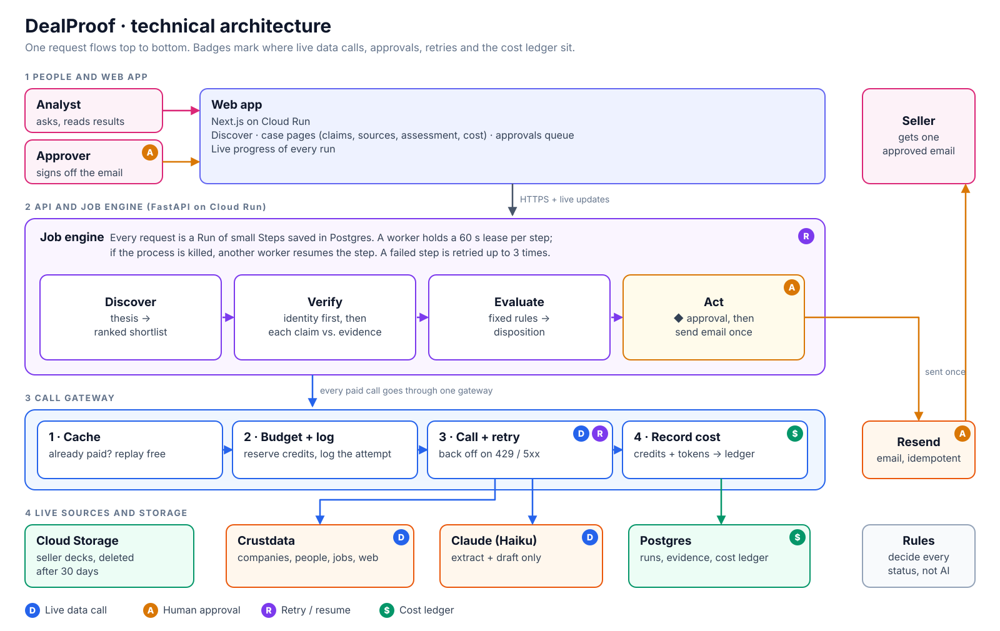

# DealProof

**ContextCon 05 · Services, Replaced · Investing track.** DealProof does the first-pass screening of an acquisition or investment target, from the request to a sourced result. It finds companies that match a thesis, confirms which legal entity each one is, checks each claim the seller makes against independent records, and decides the next step by fixed rules. A person approves any message before it goes to the seller, and it is sent once.

- Live app: https://dealproof-web-527967664479.asia-south1.run.app (API health: https://dealproof-api-527967664479.asia-south1.run.app/health)
- Architecture: [`docs/architecture/`](docs/architecture/README.md) (technical and business diagrams)
- Report: [`docs/report/DealProof-Report.pdf`](docs/report/DealProof-Report.pdf)
- Product and design: [`DealProof product description.md`](DealProof%20product%20description.md), [`docs/superpowers/specs/`](docs/superpowers/specs/), scoring policy [`apps/api/app/rules/POLICY.md`](apps/api/app/rules/POLICY.md)



## 1. The job, and who pays for it today

| | |
| --- | --- |
| **The job** | Screen an acquisition or investment target before the second meeting: find candidates that fit the buyer's thesis, confirm each company's identity, check each claim in the seller's pitch deck against outside records, and decide whether to prioritise it, investigate further, deprioritise it, or say it cannot be assessed. Then ask the seller for the documents that would settle the open questions. |
| **Who does it today** | M&A advisory firms, buy-side diligence teams and venture scouts. Their analysts do it by hand across company databases, registry lookups, the seller's deck and a spreadsheet. |
| **Who pays today** | The buyer: the CFO office or corporate development team of a mid-size company. For ContextCon this is the client's CFO office (an Indian 3PL) looking at logistics, warehousing and supply-chain technology targets. PE funds, VC funds, family offices and search funds buy the same work. They pay the advisory firm a retainer or a fee per target screened. |
| **What DealProof replaces** | The analyst's first-pass research and screening memo. It does not replace formal financial, legal or tax due diligence, which comes later. |

## 2. Input

Any one of these starts a job:

| Request | Example |
| --- | --- |
| An investment thesis in plain words | "Privately held Indian warehousing and supply-chain software companies that serve enterprise customers and show recent expansion" |
| A company to verify: name and website, plus optional seller documents (PDF deck) or typed claims | `Palms Warehouse Management System`, `onpalms.com`, and the seller's deck |
| A business profile, to find investors (the reverse direction) | sector, location, stage, size, kind of funding sought |

The thesis becomes editable criteria (must-haves and preferences) before any search runs.

## 3. The finished result

A **screening case** that reads in minutes and audits in full:

1. **Shortlist** (from a thesis): real companies ranked by fit, each shown as "Fit 82 · 70% of criteria assessable", with reasons for inclusion and unknowns.
2. **Confirmed identity**: `confirmed`, `ambiguous` or `unresolved`, with the identifiers that matched (domain, profile URL, Crustdata id, HQ, founded year, registry id). A name match alone never confirms.
3. **Claim ledger**: each claim, verbatim and normalised, with one status: `supported`, `contradicted`, `partially_corroborated`, `conflicting_evidence`, `cannot_verify` or `not_checked`. Each status shows the source link, the exact passage or field, and the date of the record. `cannot_verify` names the document that would settle it.
4. **Assessment**: five judgments kept apart (opportunity fit, evidence sufficiency, business, financial, disposition) and one disposition: `prioritise`, `investigate_further`, `deprioritise` or `cannot_assess`, with the rule that decided it. Each assessment is an immutable version, and a new version shows what changed and why.
5. **Request to the seller**: the documents that would settle each open question, deduplicated and drafted as one email. It waits for a named approver and is sent exactly once.
6. **Cost record**: Crustdata credits and model spend for every call, totalled per case and per run.

Illustration of a claim line (from the product description, not a real company): *"We employ 250 people": Cannot verify. A profile-based headcount estimate is lower, but warehouse staff rarely have professional profiles. Request a dated payroll summary.*

## 4. Pass mark

A case passes only if **all** of these hold. A wrong answer is worse than `cannot_verify`, and the rules are built that way.

| # | Check | Pass when |
| --- | --- | --- |
| 1 | Identity | The correct legal entity is confirmed on a corroborating identifier. For a **lookalike name**, the case stays `ambiguous` or `unresolved` and the disposition is `cannot_assess`. Nothing is attached on a name alone. |
| 2 | Claim statuses | Every claim gets the expected status. A claim no source can settle is `cannot_verify` and names what is missing; it is never guessed. Silence in a source never becomes `contradicted`. |
| 3 | Sources | Every fact in the output links to a record (API response field, web page or filing) and shows the exact field or passage and the record's date. No fact comes from model memory. |
| 4 | Duplicates | **Duplicate records** (the same company twice, syndicated copies of one press release, one investor under two names) are not counted twice and are not merged without a shared identifier. |
| 5 | Disposition | The disposition matches the published policy ([`POLICY.md`](apps/api/app/rules/POLICY.md) §5) for the evidence found. |
| 6 | Approval | No email leaves without a named approver. An edit after approval needs a fresh approval. The email is sent at most once. |
| 7 | Limits and restart | The case stays within its credit budget (checks past the budget show as `not_checked`, reason "budget reached"). Every call is in the cost ledger. A run killed at any moment resumes on restart without paying twice for a call or sending twice. |

The API has about 770 pytest tests in `apps/api/tests` that cover these rows, including the product description's illustration, copied announcements, sources that disagree, a silent source and a skipped check.

## 5. Data sources the service calls

| Source | Endpoint | Used for |
| --- | --- | --- |
| **Crustdata** (live) | `POST /company/identify` | Identity candidates by domain and name |
| | `POST /company/search` | Thesis search (structured filters + natural language) and comparable companies |
| | `POST /company/enrich` | Profile: industry, locations, founded year, headcount and its time series, funding rounds and investors |
| | `POST /person/search` | Leadership and founders at the confirmed company id, with dated career history |
| | `POST /job/search` | Hiring activity (a signal, never proof of revenue) |
| | `POST /web/search/live` | Dated news and events, registry-mirror pages |
| | `POST /web/enrich/live` | Fetching the exact page behind a search result so it can be quoted |
| **Anthropic Messages API** (live, `claude-haiku-5-5`) | `POST /v1/messages` | Extraction only (criteria from a thesis, claims from a deck, facts from evidence text) and drafting (memo prose, seller email). Each extracted value is checked against its source span before rules use it. |
| **Resend** (live, flag-gated) | `POST /emails` with `Idempotency-Key`; `GET /emails` to reconcile | Sending the approved seller request. With `EMAIL_SEND_ENABLED=false` it runs in test mode and nothing leaves. |
| **Seller documents** | PDF upload | Claims to check, and re-checks when the seller replies |

Storage is Neon Postgres (state, evidence, cost ledger) and a private Google Cloud Storage bucket (uploads, deleted after 30 days). Web search queries are built from public lookup terms only (company name, domain, people's names). Confidential claim text never goes into a search query.

## 6. Limits, cost and approvals

- **Cost limit:** each case has a Crustdata budget, `CASE_CREDIT_BUDGET` (default 150 credits). Discovery and investor runs have their own budgets. Budget is reserved before each paid call, so a run cannot overspend.
- **Time limit:** each call has a timeout (Crustdata 60 s, Anthropic 120 s), fan-out is bounded (top N companies enriched), and a step gets at most 3 attempts before it fails and its checks show as `not_checked`.
- **Cost ledger:** every dispatch writes a `call_attempts` row before the call and a `cost_entries` row after it (credits, tokens, USD). If the provider's response is lost, the cost is stored as *unknown*, not zero. Cached replays cost nothing and link to the run that paid.
- **Measured cost** (live showcase run, 22 Nov 2026): verifying one company with 9 claims cost **8.7 credits**. Discovering and enriching 25 companies cost **50.1 credits**, shared across every case opened from that shortlist. An investor search cost **59.2 credits**. All model calls together cost **$0.018**.
- **Approvals:** the only irreversible action is the email to the seller. A named, signed-in user approves one immutable revision (body, recipient and subject, hashed). The send key is stored with a unique constraint before dispatch and is passed as the provider's idempotency key. An `unknown` outcome is reconciled with the provider before any retry.
- **Restart:** runs are steps in Postgres. Workers claim steps with `SELECT … FOR UPDATE SKIP LOCKED` and a 60-second lease with a fencing token. If the process is killed at any point, expired leases are reclaimed on restart, cached calls replay without charge, and the send-once rule still holds.

## 7. Run it

Prerequisites: Node 22.13+ with pnpm, Python 3.12+ and uv.

```sh
cp .env.example .env        # fill in CRUSTDATA_API_KEY, ANTHROPIC_API_KEY, DATABASE_URL; never commit .env
pnpm install                # web dependencies
(cd apps/api && uv sync)    # API dependencies
(cd apps/api && uv run alembic upgrade head)

pnpm dev                    # web on :3000 and API on :8000 (the API also runs the step worker)
pnpm dev:web                # web only
pnpm dev:api                # API only
(cd apps/api && uv run python -m app.jobs.worker)   # optional standalone worker
```

Checks:

```sh
pnpm lint                   # eslint (web) + ruff (api)
pnpm test                   # pytest (api)
pnpm build                  # next build (web) + uv sync (api)
```

Health check: `curl http://localhost:8000/health` returns `{"status":"ok"}`.

Accounts:

- **Sign up** at `/signup` with your name, email and a password (10+ characters). This creates an unverified account in a new workspace and emails a confirmation link. The link works once and expires after 24 hours (`AUTH_VERIFICATION_TTL_HOURS`); only a hash of it is stored. Opening it (`/verify`) and pressing **Confirm** switches the account on and logs you in. Sign-up answers the same way for an email that is already registered, and that person gets a "you already have an account" email instead.
- **Email delivery:** through Resend when `RESEND_API_KEY` and `EMAIL_FROM` are set. Without them (local dev) the email, link included, is printed to the API console.
- **Log in** at `/login` with email and password. An unconfirmed account is refused with a "confirm your email" message and a **Send a new link** button. Sign-up, resend and log-in are rate limited per email and per client IP.
- **Staying signed in:** the `dp_session` cookie is persistent (`Max-Age`), so it survives a browser restart until the session ends after `AUTH_SESSION_TTL_HOURS` (24 by default). Log out ends it at once.
- **Admin-created accounts** count as confirmed: `cd apps/api && uv run python -m app.auth.cli create-user --email … --name … --workspace …` (see `app/auth/cli.py`). Set `AUTH_SIGNUP_ENABLED=false` (and `NEXT_PUBLIC_SIGNUP_ENABLED=false` for the web) to allow only those.

Deployment (Cloud Run `asia-south1`, Neon Postgres, GCS) is described in [`docs/deploy.md`](docs/deploy.md).

## Layout

- `apps/web`: Next.js (App Router, TypeScript, Tailwind CSS)
- `apps/api`: Python FastAPI service and step worker, managed with uv
  - `app/clients`: Crustdata and Anthropic clients (cache, retries, call records)
  - `app/jobs`: runs, steps, leases, worker
  - `app/pipelines`: discover, investors, verify, evaluate, act
  - `app/rules`: deterministic scoring and status rules (`POLICY.md`)
  - `app/act`: approval and send-once email
  - `app/db`: models, cost ledger, retention
- `docs/architecture`: architecture diagrams
- `docs/report`: the submission report
