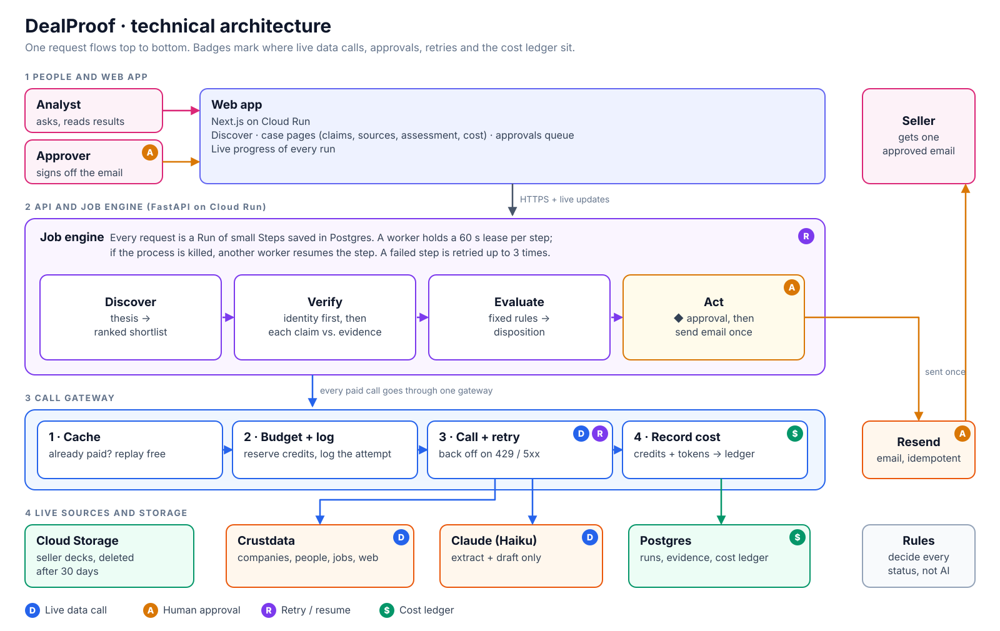
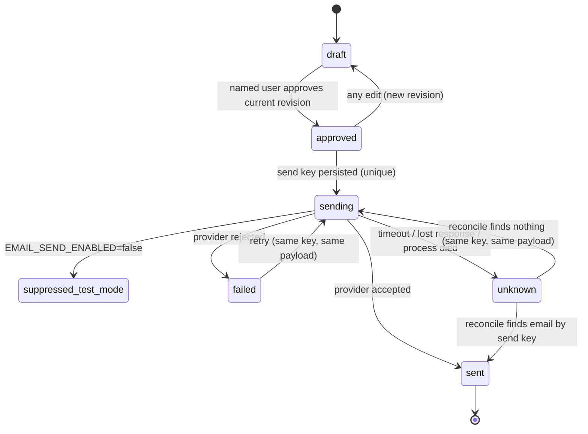
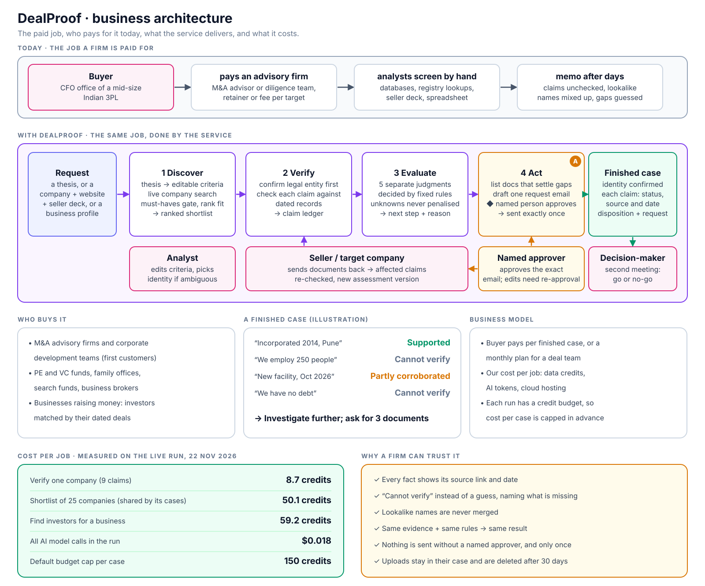

# DealProof architecture

Two diagrams:

- **Technical** ([`technical-architecture.svg`](technical-architecture.svg)): components, data flow, and where the data calls (D), approvals (A), retries (R) and the cost ledger ($) sit.
- **Business** ([`business-architecture.svg`](business-architecture.svg)): the paid job, who pays for it today, how a request becomes a finished case, and the measured cost.

Both are generated from one script so labels stay consistent. To change them, edit the script and re-run it (see the end of this page).

## Technical architecture



| Concern | Where it sits | Code |
| --- | --- | --- |
| **Data calls (D)** | Every Crustdata and Anthropic call goes through one `CallOperation`: cache lookup → pre-dispatch → dispatch → finish. No pipeline calls a provider directly. | `apps/api/app/clients/base.py`, `crustdata.py`, `llm.py` |
| **Approvals (A)** | The Act step. A named user approves one immutable message revision. The send key is stored before dispatch and used as the Resend idempotency key. | `apps/api/app/act/service.py`, `act/resend.py` |
| **Retries (R)** | Two levels. (1) HTTP: 429, 5xx, network errors and timeouts, with exponential backoff and jitter that honours `Retry-After` (Crustdata ≤ 3 retries, Anthropic ≤ 2). Each retry is its own recorded attempt. (2) Step: a failed step is retried up to 3 times (2 s to 120 s backoff), and a step whose worker died is reclaimed when its 60 s lease expires. | `clients/crustdata.py::_retry_delay`, `jobs/engine.py`, `jobs/worker.py` |
| **Cost ledger ($)** | `call_attempts` (written before the call) and `cost_entries` (credits, tokens, USD, written after it in the same transaction as the cache entry). Each entry is charged to one owner: a case, a discovery run or an investor run. Reused cache entries cost zero and link to the run that paid. | `apps/api/app/db/ledger.py`, `db/adapters.py` |
| **Budget** | Reserved in pre-dispatch. When it runs out, the remaining checks become `not_checked` ("budget reached") instead of running. | `jobs/engine.py`, `db/ledger.py` |
| **Rules** | Pure functions with no I/O, no LLM and no clock. They decide claim status, fit, sufficiency, disposition and DecisionFlip. | `apps/api/app/rules/`, `POLICY.md` |

### A run, a kill, and a restart

```mermaid
sequenceDiagram
    autonumber
    participant W1 as Worker (before kill)
    participant DB as Postgres
    participant P as Crustdata / Claude
    participant W2 as Worker (after restart)

    W1->>DB: claim step (FOR UPDATE SKIP LOCKED), lease 60 s, lease_token = t1
    W1->>DB: cache miss → reserve budget, call_attempt = started
    W1->>P: dispatch (retry on 429/5xx with backoff)
    P-->>W1: response + usage
    W1->>DB: one txn: cost_entries, cache entry, attempt = succeeded
    Note over W1: process killed here
    W2->>DB: sweep: lease expired → step back to pending
    W2->>DB: claim step, lease_token = t2 (t1 is now fenced out)
    W2->>DB: reconcile leftover "started" attempts → unknown cost
    W2->>DB: same request hash → cache hit, zero cost
    W2->>DB: step done; next steps proceed
```

### Send exactly once



## Business architecture



## Regenerating the diagrams

```sh
python docs/architecture/gen_diagrams.py docs/architecture
```
